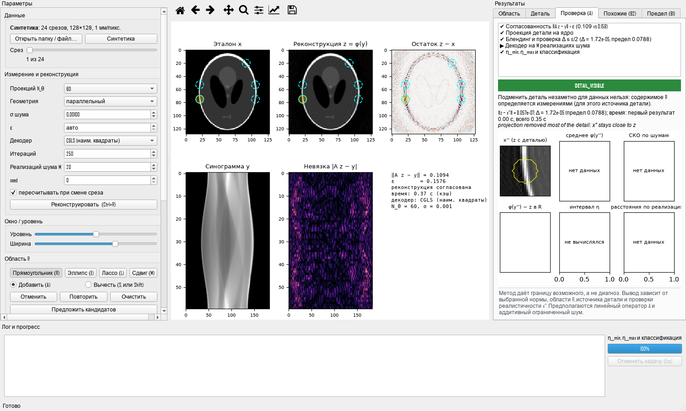
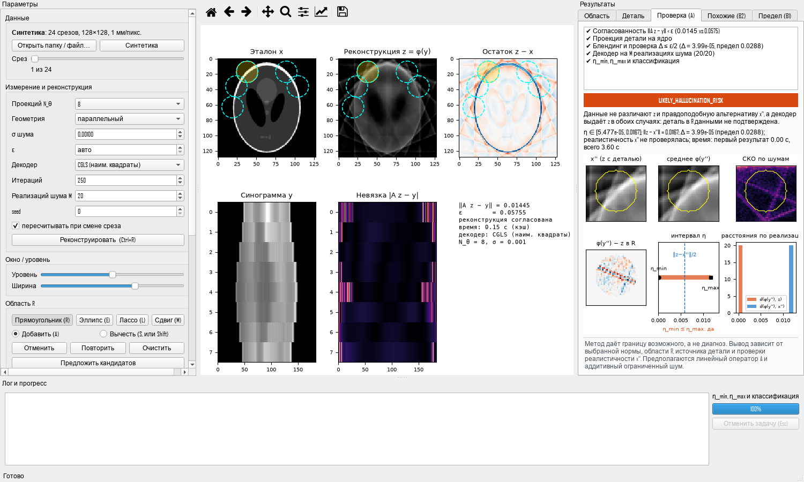
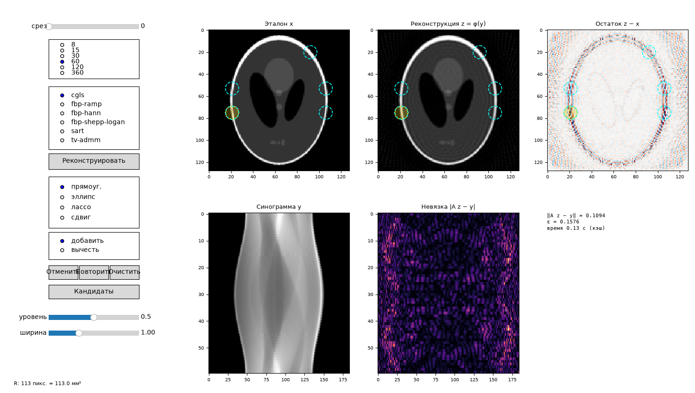

# nullgraft

Проверка достоверности деталей в КТ-реконструкции по статье Iagaru, Gottschling, Hansen, Garnier,
*On Hallucinations in Inverse Problems: Fundamental Limits and Provable Assessment Methods*
(arXiv:2605.13146, 2026).

Пакет даёт **границы возможного, а не диагноз**. Статус `LIKELY_HALLUCINATION_RISK` значит: «данные не могут
подтвердить эту деталь, и декодер показал бы её, даже если бы её не было». Это не «доказанная галлюцинация».

**Подробная документация по каждому алгоритму, его сути и математике — в [docs/](docs/README.md)**: прямой
оператор, проекция на ядро, Алгоритм A, B1, B2, декодеры, метрики, данные, визуализация в демо
([09](docs/09_visualization.md)) и производительность ([10](docs/10_performance.md)).

## Что реализовано

| Модуль                    | Содержание                                                                                                                                                                                                                                                                                                                                                                                                                                                   |
| ------------------------- | ------------------------------------------------------------------------------------------------------------------------------------------------------------------------------------------------------------------------------------------------------------------------------------------------------------------------------------------------------------------------------------------------------------------------------------------------------------ |
| `operators.py`            | `Geometry` (parallel / fan-beam с плоским детектором, `N_θ` — параметр), `RadonOperator`: `A`/`At`, батчи `(B,H,W)`, `LinearOperator` (в том числе с ограничением на столбцы `A_R`), оценка `‖A‖₂`, маска лучей `ray_mask(R)`. Бэкенды: `pixel` (по умолчанию на CPU: matrix-free, **точный** транспонированный оператор, кэш CSR при наличии памяти), `astra` (выбирается автоматически, если установлен; GPU, если доступен), `skimage` (эталон/fallback). |
| `nullspace.py`            | `P_N(x) = x − A⁺(Ax)` через `scipy.sparse.linalg.lsqr` на `LinearOperator`; логирование `‖A x_proj‖/‖A x‖`; LRU-кэш по хэшу (деталь, маска, геометрия, допуски); warm start; `local_kernel_element` — элемент ядра с носителем в `R`.                                                                                                                                                                                                                        |
| `decoders.py`             | `Decoder.reconstruct(y) → (L,H,W)`, `reconstruct_batch → (M,L,H,W)`. FBP (окна ramp/hann/shepp-logan/cosine; параллельный и веерный пучок), SART, TV-ADMM (батчевый CG), `PerturbedDecoder` (стохастический, воспроизводимый), `TorchPostProcessingDecoder` (заглушка нейросети: веса из файла, `inference_mode`, батчи, fp16/bf16).                                                                                                                         |
| `graft.py`                | Алгоритм A, шаги 2–5: `x_det=(x_source−z)·1_R`, проекция, окно `α(r)` (cosine/gaussian), `x''=z+α·x_det^proj`, `Δ=‖A(α x_det^proj)‖ ≤ 0.5ε`.                                                                                                                                                                                                                                                                                                                 |
| `assess.py`               | Алгоритм A: consistency check, `M` шумовых реализаций одним батчем, Хаусдорф для стохастических декодеров, `η_min/η_max`, классификация (`INCONSISTENT`, `BLEND_INVALID`, `LIKELY_HALLUCINATION_RISK`, `DETAIL_VISIBLE`, `UNINFORMATIVE`, `INCONCLUSIVE`), подключаемый `RealismChecker` (по умолчанию `ArchivePatchRealism`), `calibrate_null_detail`.                                                                                                      |
| `feasible.py`             | Алгоритм B1: архив патчей (memmap, чекпоинты), Алгоритм 1 (`FA`, `Com=FA·FAᵀ` в `csr_matrix`) с радиусным поиском `cKDTree`/FAISS и точной проверкой, Алгоритм 2 (диаметры, экстремальная пара), кривая сходимости.                                                                                                                                                                                                                                          |
| `similar.py`              | Алгоритм B2: дескрипторы артефактов (нормированный патч, радиальный профиль `\|FFT\|`, энергия, structure tensor), индекс `cKDTree` на диске, батчевые запросы, NCC, «реальная структура / фон» по эталону или сегментации, сводка.                                                                                                                                                                                                                          |
| `metrics.py`              | `‖·‖_{p,q,R}` (набор областей, нормировка на `\|R\|`), Хаусдорф до точки, RMSE, SSIM, HU-ошибка, Dice.                                                                                                                                                                                                                                                                                                                                                       |
| `data/`                   | Синтетика (Shepp-Logan, эллипсы, «объём» с дрейфом между срезами), загрузчик VHP (DICOM/PNG/NPY; размер пикселя, шаг и нумерация **читаются из файлов**), разбиения по блокам срезов и анатомическим областям.                                                                                                                                                                                                                                               |
| `scripts/register_vhp.py` | Регистрация криосрезов на сетку КТ (SimpleITK: аффинная + B-spline, взаимная информация), лог TRE и Dice.                                                                                                                                                                                                                                                                                                                                                    |
| `experiments/`, `cli.py`  | `nullgraft assess / feasible / similar / benchmark / report`, YAML-конфиги, возобновляемые результаты (JSONL, memmap, `progress.json`).                                                                                                                                                                                                                                                                                                                      |

## Математика (соответствие статье)

* Модель `y = A x + e`, `‖e‖ < ε`, `A` линеен.
* Согласованность декодера (Def. 2.1): `‖A z − y‖ < ε`. Иначе `INCONSISTENT`, анализ не проводится.
* **Алгоритм A** (Thm. 3.2, Sec. 4.2). `x''` играет роль истинного сигнала, `z − x''` — роль перенесённой детали:
  * `η_min = max_m d(φ(y''+e_m), z)`, `η_max = min_m d(φ(y''+e_m), x'')`, где `d(x, φ(y)) = max_{u∈φ(y)} ‖u − x‖_{p,q,R}`;
  * интервал размеров галлюцинации непуст, если `η_min ≤ η_max` и `η_min ≤ ‖z − x''‖/2`;
  * шум `e_m` гауссов и радиально ужат внутрь шара `‖e‖ < ε − Δ`, так что `z` остаётся допустимым для каждого `y''_m`
    (подробности и вывод — [docs/03_algorithm_A.md](docs/03_algorithm_A.md)).
* **Алгоритм B1** (Algorithms 1–2, Thm. 3.9): `diam(F_y^N) ≤ diam(F_y)` при любом `N`, сходимость снизу. Нижняя граница
  ошибки любого декодера на `F_y`: `diam/2` (Remark 2.4/3.4).

## Установка и запуск

```bash
python -m venv .venv
```

```bash
.venv/Scripts/python -m pip install -e ".[dev]"
```

Опционально: `.[astra]`, `.[torch]`, `.[faiss]`, `.[registration]`, `.[dicom]`. Работа без GPU поддерживается: ASTRA и
PyTorch не обязательны.

```bash
.venv/Scripts/python -m pytest -q
```

Эксперименты на синтетике (данные не нужны):

```bash
nullgraft assess --config nullgraft/experiments/configs/synthetic.yaml --out runs/syn
```

```bash
nullgraft feasible --config nullgraft/experiments/configs/synthetic.yaml --out runs/syn
```

```bash
nullgraft similar --config nullgraft/experiments/configs/synthetic.yaml --out runs/syn
```

```bash
nullgraft benchmark --config nullgraft/experiments/configs/synthetic.yaml --out runs/bench
```

Выход: `assess.jsonl` / `assess_summary.json` / `calibration.json`; `diameters.csv` (размер `F^N`, диаметр, пара
`x, x'` для показа эксперту), `convergence.csv` (+ `convergence.png`, если установлен matplotlib);
`similar_matches.csv` / `similar_summary.json`; `benchmark.json` / `benchmark.csv`. Остановленный запуск продолжается
с места остановки.

### Пример API

```python
from nullgraft.operators import make_operator
from nullgraft.decoders import SART
from nullgraft.assess import DetailAssessor, AssessmentConfig, ArchivePatchRealism

op = make_operator((256, 256), n_angles=60)            # parallel-beam, ASTRA если есть
dec = SART(op, n_iter=200, nonneg=False)
realism = ArchivePatchRealism().fit(train_slices)        # или свой RealismChecker
res = DetailAssessor(op, dec, AssessmentConfig(eps=eps, noise_sigma=sigma), realism).assess(y, source, region_R)
print(res.summary())
```

## Данные: NLM Visible Human Project

Код ничего не скачивает: путь к данным передаётся аргументом `--data`.

* Оригинал: https://datadiscovery.nlm.nih.gov/Images/Visible-Human-Project/ux2j-9i9a/about_data
* DICOM: коллекция `NLM-Visible-Human-Project` в NCI Imaging Data Commons (манифесты: https://zenodo.org/records/12690050),
  загрузка через `idc-index`.

Порядок работы:

1. `nullgraft report CT_DIR` печатает размер пикселя, шаг и диапазон z, формы и монотонность нумерации, **реально
   найденные в файлах**. Цифры из описания проекта 1995 г. не используются.
2. `python scripts/register_vhp.py --ct CT_DIR --cryo CRYO_DIR --cryo-pixel-mm <из метаданных> --out REG_DIR
   [--pairs pairs.csv] [--landmarks landmarks.csv]` выполняет аффинную и B-spline регистрацию и пишет лог Dice (маски
   тела) и TRE (по ориентирам) в `registration_log.json`. Срезы с плохими TRE/Dice нужно исключить: остаточное
   несовпадение геометрии не должно засчитываться как «деталь».
3. `nullgraft assess --config nullgraft/experiments/configs/vhp.yaml --data REG_DIR --out runs/vhp`.

Эталон `x` — криосрез в градациях серого, приведённый к сетке КТ (антиалиасинг-даунсэмплинг с совпадением mm/pixel,
`cryo_to_ct_grid`). Исходное разрешение хранится отдельно и используется для выбора мелких деталей.
Разбиение train/test делается **блоками срезов** (`block_split`, с защитным зазором) или по анатомическим областям
(`region_split`), но никогда по отдельным срезам. CVH и VKH (по запросу к авторам) подключаются тем же интерфейсом
`npy`/`vhp_registered`; сегментацию VKH можно передать в `ArtifactIndex.build(segmentations=...)` и использовать для `Dice`.

## Ограничения

* **Линейный `A` и аддитивный ограниченный шум** `‖e‖ < ε`. Пуассоновская статистика, beam hardening и рассеяние
  не моделируются.
* **Реалистичность `x''` требует отдельной проверки.** `ArchivePatchRealism` — грубый эвристический критерий
  (расстояние до ближайшего патча архива). Для клинических выводов нужен свой классификатор (`RealismChecker`).
* **Патч-адаптация B1 для Radon** (см. «Допущения», п. 6). Допустимость патча оценивается без остального изображения:
  взаимодействие с окружающей анатомией игнорируется, `y_k` тоже должны быть измерениями вставленных патчей, `ε`
  относится к измерению патча. При `placement="original"` патч сравнивается только с патчами на той же позиции
  (Radon не инвариантен к сдвигу), при `placement="center"` позиция игнорируется. Это осознанное приближение, а не
  результат статьи.
* **Оценки диаметров только снизу** (Thm. 3.9): `diam(F^N) ≤ diam(F)`. Малое значение может означать недостаток
  данных в архиве (смотрите выход кривой сходимости на плато).
* **Усечённый LSQR**: компоненты вдоль очень малых сингулярных чисел остаются в `x_proj` (они почти невидимы).
  Поэтому `P_N` из LSQR не идемпотентен поточечно (до ~10 % на тестовой задаче), хотя `‖A x_proj‖/‖Ax‖ ~ 1e-4`.
  Качество всегда проверяется по невязке, а тест сравнивает результат с точным SVD-проектором.
* Pixel-driven проектор с линейной интерполяцией — приближение лучевых интегралов. Его точность проверена тестами
  (интегралы диска, сохранение массы); для физически точных данных используйте ASTRA.
* В VHP всего 2 субъекта, поэтому выводы о межсубъектной обобщаемости ограничены.
* Порог реалистичности `ArchivePatchRealism` берётся по ближайшим соседям **из других срезов** (перекрывающиеся
  патчи того же среза сделали бы его слишком строгим). Соседние срезы реального КТ почти совпадают, поэтому для VHP
  архив реалистичности стоит строить по срезам с шагом (например, каждый 10-й).
* Подпапки `fp_<hash>` старых сборок не удаляются автоматически: удаляйте их вручную, когда они не нужны.
* Не проверено в этой среде, так как зависимости не установлены: бэкенд ASTRA (тест есть, пропускается), нейросетевой
  декодер (PyTorch), путь FAISS, чтение DICOM (pydicom), регистрация (SimpleITK).

## Допущения

1. **Оператор по умолчанию — собственный pixel-driven, а не `skimage.radon`.** LSQR требует точной пары `A`/`Aᵀ`.
   `iradon(filter=None)` не является точным транспонированием `radon` и не поддерживает fan-beam. `skimage`
   оставлен как бэкенд с предупреждением; ASTRA выбирается автоматически, если установлен.
2. **`η_min` и `η_max`.** В формулировке задачи `z` и `x''` в формулах переставлены относительно статьи (Thm. 3.2,
   Sec. 4.2) и противоречат словесному описанию исходов из той же задачи. Реализовано по статье:
   `η_min = max d(φ(y''+e), z)`, `η_max = min d(φ(y''+e), x'')`, условие `η_min ≤ min(η_max, ‖z−x''‖/2)`.
3. **Исходы.** `DETAIL_VISIBLE` присваивается и тогда, когда проекция убрала ≥ 90 % детали (`‖z−x''‖ ≤ 0.1‖x_det‖`):
   это исход статьи «x'' остаётся близок к z → детали можно доверять». Добавлен статус `INCONCLUSIVE` (нулевая
   деталь, деталь ниже калиброванного порога или промежуточный случай).
4. **Локализованная норма** — по статье (Sec. 5.1.1): `(Σ_{R∈𝓡} ‖·‖_{q,R}^p)^{1/p}` для набора областей, с
   нормировкой каждой `‖·‖_{q,R}` на `|R|^{1/q}`; по умолчанию `p=q=1` (среднее `|·|` по `R`).
5. **Патчи в B1.** Remark 3.8 статьи говорит о неявных прямых отображениях (запуск Алгоритма 1 на парах `(x_n, y'_n)`),
   а не о патчах. Мы используем именно эту возможность с парами `(p_n, A(E_n p_n))`, где `E_n` — вставка патча в нулевое
   изображение в позицию его центра.
6. **Фильтр кандидатов B1.** Признаки `Q·A(E p)`, где `Q` — блочный пулинг `1/√b` и PCA (ортонормированные строки),
   так что `‖Q v‖ ≤ ‖v‖`. Радиусный поиск с радиусом `ε` поэтому возвращает надмножество допустимых пар, затем каждая
   пара проверяется точно, и пропусков нет (проверено тестом против перебора). FAISS IVF (опционально) может
   пропустить кандидатов; это только уменьшает диаметры, то есть сохраняет свойство нижней границы.
7. **Маска лучей.** «Считать `A x_det` только по лучам через `R`» реализовано как проекция только пикселей носителя
   (`forward(x, support=R)`, точно совпадает с полным `A x`). Ограничивать сам LSQR строками через `R` нельзя: это
   изменило бы ядро (`ker A_S ⊋ ker A`).
8. **Большие `F^N`** (`> exact_limit`): диаметр считается повторными проходами «дальней точки». Выпуклая оболочка
   в размерности патча (~10³) неприменима. Результат помечается `approximate` и не превышает точного.
9. **SART** реализован в одноблочной (SIRT) форме; **TV-ADMM**: `λ`, `ρ` задаются относительно `‖A‖²`.
10. Для стохастических декодеров `z` — медоид семплов `φ(y)`.
11. **B2.** При запросе истинный остаток неизвестен, поэтому дескриптор строится по оценке артефакта
    `a = z − G_σ*z` (одинаково для архива и запроса). Истинный остаток `r_n = z_n − x_n` хранится в архиве, а режим
    `residual_mode="true"` предназначен для валидации, когда остаток запроса известен. «Реальная структура» означает
    контраст эталона в центре патча выше порога (по умолчанию 10 % динамического диапазона) или > 10 % размеченных
    пикселей сегментации.
12. **Калибровка.** Порог равен 99 %-квантилю `η_min` (флуктуации декодера вокруг `z`) на нулевых и малых деталях;
    риск сообщается только при `‖z−x''‖ > 2·порог`.
13. `ε = eps_factor · σ · √n_rays` (так как `E‖e‖² = σ² n_rays`).
14. Fan-beam: плоский детектор, полный оборот 2π; длины в пикселях (`pixel_size_mm` — метаданные).
15. Память в бенчмарке измеряется через `tracemalloc` (куча Python/numpy, без памяти внешних библиотек), в отдельном
    прогоне, чтобы трассировка не искажала время.
16. **Шум в алгоритме A** сэмплируется в шаре `‖e‖ < 0.99(ε − Δ)`. Тогда `‖A z − (A x'' + e)‖ ≤ Δ + ‖e‖ < ε`, то есть
    `z` остаётся допустимым для каждого `y''_m`, и тест не становится искусственно консервативным.
17. **`DETAIL_VISIBLE` по проекции**: доля детали считается по `‖P_N(x_det)‖` до окна. Если деталь «съело» окно
    `α` (слишком маленькая `R`), результат `INCONCLUSIVE` с пояснением, а не `DETAIL_VISIBLE`.
18. **Чекпоинты и повторные запуски.** Каждая сборка (архив патчей B1, индекс артефактов B2) получает отпечаток:
    оператор, декодер, шум, параметры патчей, дескрипторов и seed, а также дайджест данных. Сборка лежит в своей
    подпапке `fp_<hash>`. Возобновляется только сборка с тем же отпечатком, а при изменении данных или параметров
    создаётся новая (уже открытые memmap-файлы на Windows перезаписать нельзя). Индекс B2 не хранится через pickle:
    KD-дерево пересобирается из дескрипторов при загрузке. Файлы прогресса пишутся атомарно, обрезанная последняя
    строка `assess.jsonl` после сбоя пропускается, шум задаётся seed'ом на каждый срез, поэтому возобновлённый
    запуск воспроизводим.

## Производительность

Порядок работы: сначала профилирование (`cProfile`), затем оптимизация только найденных узких мест, каждая
с тестом-эталоном. Конфигурация: CPU, 128×128, 60 проекций, без ASTRA; `nullgraft benchmark --quick`.

| Операция                                  | До                     | После         | Причина (по профилю)                                                                                                          |
| ----------------------------------------- | ---------------------- | ------------- | ----------------------------------------------------------------------------------------------------------------------------- |
| `A x` / `Aᵀ y` (кэш CSR)                  | ≈4 мс                  | ≈1 мс         | матрица float32 × вектор float64: scipy перекастовывал 2M ненулевых на каждом вызове (замер 3.4×); матрица хранится в float64 |
| Полная проверка детали (алгоритм A, M=20) | 13.3 с                 | 9.2 с         | LSQR быстрее; остаток — 20×100 итераций SART батчем (сам декодер)                                                             |
| B1: построение архива, N≈10³              | 2.8 с                  | 0.86 с        | 27 000 вызовов `_interp`: прямой проектор вызывается теперь один раз на позицию для пачки срезов, углы кэшированы             |
| B1: диаметры, N≈10³                       | 5.4 с                  | 2.9 с         | копирование через булеву маску при `R` = весь патч                                                                            |
| B1: Алгоритм 1, KD-фильтр vs перебор      | перебор 5.2 с / 2.2 ГБ | 1.4 с / 24 МБ | O(N log N) вместо O(N·K) и без плотного массива расстояний                                                                    |

Полный прогон (`nullgraft benchmark --config nullgraft/experiments/configs/synthetic.yaml`, финальный код, CPU,
128×128, 60 проекций, патчи 16×16 с шагом 8, ~100 запросов `y_k`). Пиковая память измерена через `tracemalloc`
в отдельном прогоне:

| Операция                         | N патчей | Время   | Пик памяти | Примечание                                    |
| -------------------------------- | -------- | ------- | ---------- | --------------------------------------------- |
| `A x` / `Aᵀ y`, кэш CSR          | —        | 1 мс    | 0.3 МБ     | matrix-free: 14 / 18 мс                       |
| `A x` для батча 20               | —        | 27 мс   | 6.7 МБ     |                                               |
| Проверка детали (A, M=20, SART)  | —        | 8.9 с   | 10.5 МБ    | время в основном уходит на декодер            |
| B1: архив                        | 10³      | 0.69 с  | 5 МБ       |                                               |
| B1: Алгоритм 1                   | 10³      | 1.0 с   | 24 МБ      | перебор: 4.6 с / 2.2 ГБ, те же 6418 пар       |
| B1: Алгоритм 2                   | 10³      | 2.4 с   | 128 МБ     |                                               |
| B1: архив                        | 10⁴      | 4.0 с   | 40 МБ      |                                               |
| B1: Алгоритм 1                   | 10⁴      | 8.0 с   | 26 МБ      | 62 тыс. кандидатов → 45 тыс. допустимых пар   |
| B1: Алгоритм 2                   | 10⁴      | 2.4 с   | 15 МБ      |                                               |
| B1: архив                        | 10⁵      | 46 с    | 366 МБ     |                                               |
| B1: Алгоритм 1                   | 10⁵      | 108 с   | 49 МБ      | 627 тыс. кандидатов → 476 тыс. допустимых пар |
| B1: Алгоритм 2                   | 10⁵      | 43 с    | 148 МБ     | большие `F^N` считаются приближённо (снизу)   |
| B2: индекс                       | 980      | 0.71 с  | 16 МБ      | 20 срезов                                     |
| B2: 256 запросов                 | 980      | 0.07 с  | 14 МБ      |                                               |

Время Алгоритма 1 растёт с числом **допустимых** пар, а не с N² (≈0.2 мс на точную проверку кандидата). На этой
синтетике допустимых пар много, потому что срезы синтетического объёма почти одинаковы. Узкое место при 10⁵ —
точная перепроверка кандидатов (пересчёт `A(E_n p_n)`). Если понадобится ускорение, следующий шаг — кэшировать
измерения патчей на диске (memmap) при наличии места. Сейчас это не сделано.

Тест на регресс производительности: `tests/test_perf.py` (маркер `perf`). Пороги берутся из
`benchmark.max_seconds` конфига (по умолчанию мягкие); свой конфиг задаётся через `NULLGRAFT_PERF_CONFIG`.

## Демо-приложение `nullgraft_demo`

Локальное окно (без веба и браузера) для пошаговой демонстрации Алгоритма A: открыть срез, выделить мышью
подозрительную область, запустить проверку и увидеть каждую стадию и итоговый исход.

### Установка и запуск

```bash
pip install -e ".[demo]"
```

```bash
python -m nullgraft_demo
```

```bash
python -m nullgraft_demo --data PATH
```

Без `--data` открывается синтетика: срез 0 — фантом Шеппа–Логана, остальные — «объём» дрейфующих эллипсов.
`PATH` — папка Visible Human (выход `scripts/register_vhp.py`, где лежит `cryo.npy`) или файл среза
(PNG/TIFF/JPEG, `.npy`, DICOM). Другие ключи:

* `--ui qt|mpl` — интерфейс: PyQt6 (основной) или чистый matplotlib (запасной); без PyQt6 автоматически `mpl`;
* `--config FILE.yaml` — настройки поверх `nullgraft_demo/default.yaml`;
* `--cache-dir DIR` — кэш реконструкций (по умолчанию `~/.cache/nullgraft_demo`);
* `--screenshot FILE.png` — выполнить демо-сценарий (реконструкция → кандидаты → проверка), сохранить снимок и выйти.

GPU не нужен. ASTRA и PyTorch необязательны.

### Окно

* **Слева — параметры.** Источник данных и слайдер среза; N_θ (8/15/30/60/120/360), геометрия, σ, ε, декодер,
  итерации, M, seed; окно/уровень; инструменты выделения; деталь и запуск проверки.
* **В центре — сетка matplotlib.** Эталон x, реконструкция z, остаток z − x (общие оси: зум и панорамирование
  синхронны), синограмма y и невязка |A z − y| (общие оси между собой). Маска R показана полупрозрачной заливкой
  и контуром на всех панелях изображения. В строке состояния — пиксель, значения x и z и HU.
* **Справа — вкладки.** «Область»: площадь в пикселях и мм², эквивалентный диаметр, предупреждение «мельче
  разрешения оператора», кандидаты. «Деталь»: превью x_det, A⁺A x_det, x_det^proj и ‖A x_det^proj‖/‖A x_det‖.
  «Проверка (A)»: чек-лист стадий, цветной бейдж исхода с расшифровкой, x'', среднее φ(y''), СКО по шумам,
  φ(y'') − z в R, интервал [η_min, η_max] с отметкой ‖z − x''‖/2, гистограмма расстояний и постоянный блок
  оговорок.
* **Дальше справа — вкладки этапов 6–9.**
  * «Сравнение»: 2–4 декодера на одной синограмме, с одним шумом, одной областью и деталью. Для каждого —
    бейдж, интервал η и изображение; таблица метрик: ‖z − x‖ в R, ошибка в HU, SSIM, ‖Az − y‖/ε.
  * «Похожие (B2)»: top-K патчей архива с похожим артефактом того же декодера (реконструкция, остаток, эталон,
    расстояние, NCC) и доля «структура / фон». Клик по патчу открывает его срез и позицию.
  * «Предел (B1)»: diam(F_y^N) и diam/2 в зависимости от N_θ с выделенной текущей точкой, пара x, x' и кривая
    сходимости с пометкой «оценка сходится снизу».
  * «Карта риска»: грубая тепловая карта поверх реконструкции.
* **Меню «Файл»** — сессия (JSON + .npz), отчёт .docx, все панели в PNG.
* **Внизу** — лог, прогресс-бар и отмена задачи. Реконструкция сначала показывает быстрое FBP-превью, затем
  подменяется результатом выбранного декодера.

### Горячие клавиши

| Клавиши | Действие |
|---|---|
| R / E / L / M | прямоугольник / эллипс / лассо / сдвиг выделения |
| A / S (или Shift при выделении) | режим «добавить» / «вычесть» |
| Ctrl+Z, Ctrl+Y (Ctrl+Shift+Z) | отмена / повтор правки маски |
| Delete | очистить маску |
| Ctrl+R | реконструировать |
| Ctrl+Enter | запустить проверку детали |
| Esc | отменить текущую задачу |
| PgUp / PgDown | предыдущий / следующий срез |
| Ctrl+S / Ctrl+O | сохранить / открыть сессию (JSON + .npz) |
| Ctrl+D | отчёт .docx |
| Ctrl+P | сохранить все панели в PNG |

### Снимки (синтетика, 128×128)

60 проекций, CGLS: удаление участка вокруг первого кандидата. Исход `DETAIL_VISIBLE`: проекция на ядро
внутри R убирает почти всю деталь, и подменить её незаметно для данных нельзя.



8 проекций, CGLS, проверка реалистичности выключена (см. «Допущения демо», п. 5). Исход
`LIKELY_HALLUCINATION_RISK`: интервал η непуст, среднее φ(y'') совпадает с z, а не с x''.



Запасной интерфейс на `matplotlib.widgets` (`--ui mpl`) покрывает этапы 1–3: загрузку, реконструкцию, сетку,
выделение и кандидатов. Проверка детали, сравнение, B1, B2 и экспорт есть только в Qt-окне.



### Что добавлено в `nullgraft` для демо

* `nullgraft/api.py` — тонкие обёртки:
  * `decoder_from_name(name, op, n_iter)` и `DECODER_NAMES`;
  * `decoder_signature` (ключ кэша);
  * `detector_residual` (|A z − y|);
  * `default_eps` ($\varepsilon = k\sigma\sqrt{n_{rays}}$);
  * `local_resolution(op, center)` (оценка разрешения оператора в точке).
* `decoders.CGLS` — сопряжённые градиенты для наименьших квадратов (эквивалент LSQR, батчево, float64).
  Согласован при 250 итерациях; SART для этого требует тысяч итераций (замер: 200 итераций дают невязку
  10.9 при ε = 0.16, 3000 итераций за 14 с дают 0.36).
* `DetailAssessor.assess(..., on_stage=...)` — колбэк после каждой стадии. `AssessmentConfig.batch_size` — прогон
  декодера порциями с прогрессом. `Assessment.extras` — x_det, x_proj, x'', среднее и СКО выходов для отрисовки.
  Логика алгоритма не изменилась.
* `NullspaceProjector.project_local` и `Grafter(projection="local")` — проекция на $\ker A \cap \{\operatorname{supp} \subset R\}$,
  то есть $x_{det} - A_R^{+}A_R\,x_{det}$ (см. «Допущения демо», п. 3).

### Допущения демо

1. **Декодер по умолчанию — CGLS.** Теорема требует согласованного декодера, а SART при разумном числе итераций
   несогласован, поэтому проверка сразу вернула бы `INCONSISTENT`.
2. **Общие оси.** Синхронный зум общий для панелей в пространстве изображения (x, z, z − x) и отдельно для панелей
   в пространстве детектора (y, |A z − y|): у них разные координаты.
3. **Проекция «на ядро внутри R» по умолчанию.** Глобальная $P_N x_{det}$ нелокальна (полосы вдоль лучей через R),
   и после окна α в данных остаётся след Δ ≫ ε/2, так что почти любая реальная деталь даёт `BLEND_INVALID`.
   Проекция на подпространство ядра с носителем в R тоже даёт элементы $\ker A$, так что Теорема 3.2 применима.
   Окно α в этом режиме применяется **до** проекции, поэтому Δ ≈ 0 (после проекции вклейка снова вышла бы из ядра).
   Глобальный вариант из постановки доступен переключателем.
4. **Режимы детали.** «Удалить деталь»: источник — бигармонический инпейнтинг z по R, то есть проверка, могла ли
   деталь отсутствовать. «Добавить деталь»: источник — другой срез (со сдвигом, его можно указать мышью на
   срезе-источнике) или файл, вписанный в ограничивающий прямоугольник R.
5. **Реалистичность** — `ArchivePatchRealism` по срезам архива, далёким от текущего (дальше ±2). На синтетике
   срез 0 (Шепп–Логан) не похож на остальные (эллипсы), поэтому там проверка отвергает любые x''.
   Ключ конфига `realism_check` задаёт начальное состояние галочки. Если других срезов меньше двух, проверка
   пропускается с предупреждением.
6. **Разрешение оператора** в точке R оценивается как $\max(\Delta t, \rho\,\Delta\theta)$, где $\rho$ — расстояние
   от центра вращения. Предупреждение выводится, если эквивалентный диаметр R меньше этой величины.
7. **HU в строке состояния.** Для данных в единицах ослабления (DICOM) — по $\mu_w$. Для синтетики и криосрезов —
   «условные HU» с опорным значением `arb_water` из конфига.
8. **Фоновые задачи** выполняются в пуле потоков: numpy и scipy отпускают GIL. Пул процессов (`submit_process`) есть
   для чистых функций без прогресса. Отмена срабатывает между стадиями и порциями декодера, а не посреди одного
   вызова декодера.
9. **Python 3.12** в среде разработки (3.11 не установлен); код рассчитан на ≥3.11.
10. **Превью** реконструкции — FBP (Hann) на полном разрешении, а не уменьшенное изображение: FBP на порядок
    быстрее CGLS и даёт ту же геометрию, поэтому окно сразу показывает картинку, а затем подменяет её
    результатом выбранного декодера. Алгоритм A всегда считается на полном разрешении.
11. **Сравнение декодеров.** Синограмма y и шум общие (они задаются срезом, геометрией, σ и seed). Для режима
    «удалить деталь» источник строится по z каждого декодера.
12. **B2.** Индекс строится по срезам архива, далёким от текущего (не больше 16). Он кэшируется на диске по
    отпечатку (декодер, геометрия, шум, данные) в `<cache_dir>/b2`. Реконструкция и остаток для показа
    пересчитываются для найденных срезов (из кэша реконструкций). Кандидаты областей из B2 не сделаны:
    кандидаты предлагаются по пикам остатка.
13. **B1.** Патч вокруг центра R (24×24 при 128²) и патчи всех других срезов вставляются в центр изображения
    (`placement="center"`, см. `docs/04_algorithm_B1.md`). Для каждого N_θ из {8, 15, 30, 60, 120} строится
    архив, ε = 1.5·σ·√n_rays, и диаметр считается в норме ‖·‖_{1,1}. Результат кэшируется по
    (данные, срез, центр, N_θ, σ, seed). На синтетике с 24 срезами допустимые множества малы, и оценки снизу
    сильно занижены.
14. **Карта риска** — грубая оценка. В каждом окне (радиус ≈ шаг/2, только внутри тела) выполняется режим
    «удалить деталь» с M = 4, проекцией внутри окна и без проверки реалистичности. Значение — доля реализаций
    шума, где φ(y'') ближе к z, чем к x''.
15. **Отчёт** — только .docx (PDF не делался). В него входят параметры, область, исход с расшифровкой, η_min и
    η_max, сетка, панель проверки, превью детали и блок оговорок.

### Ограничения

Линейный оператор A и аддитивный ограниченный шум. Реалистичность x'' проверяется отдельно и грубо (по
ближайшему патчу архива). Вывод зависит от нормы, области R и источника детали. Оценки диаметров B1 только снизу.
Демо показывает **границу возможного, а не диагноз**.

### Статус этапов

| Этап | Состояние |
|---|---|
| 1. Загрузка и параметры, кэш реконструкций | готово |
| 2. Сетка изображений, окно/уровень, значения под курсором | готово |
| 3. Выбор области (rect/ellipse/lasso, add/subtract, сдвиг, undo/redo), площадь, разрешение, кандидаты по остатку | готово (кандидаты из B2 — вместе с этапом 7) |
| 4. Источник детали и превью проекции | готово |
| 5. Пошаговый запуск Алгоритма A, бейдж, интервал η, гистограммы, оговорки | готово |
| 6. Сравнение декодеров | готово |
| 7. Похожие артефакты (B2) | готово (кандидаты из B2 — нет, см. «Допущения демо», п. 12) |
| 8. Предел задачи (B1) | готово |
| 9. Карта риска | готово (грубая оценка) |
| 10. Экспорт: сессия JSON+npz, отчёт .docx, PNG всех панелей | готово |
| Превью реконструкции, `experiments/benchmark_demo.py` | готово (превью — FBP, см. п. 10) |

### Производительность демо

Замер `python experiments/benchmark_demo.py --sizes 128 256 512`: CPU этого компьютера, Шепп–Логан, 60 проекций,
CGLS 250 итераций, M = 20, режим «удалить деталь», проекция внутри R:

| Срез | Оператор | Реконструкция | Первый результат | Проверка целиком | Исход |
|---|---|---|---|---|---|
| 128² | 0.09 с | 0.87 с | 0.002 с | 0.23 с | `DETAIL_VISIBLE` |
| 256² | 0.41 с | 4.6 с | 0.008 с | 0.008 с | `INCONSISTENT` |
| 512² | 2.3 с | 32.7 с | 0.04 с | 0.04 с | `INCONSISTENT` |
| 512², 15 проекций | 0.66 с | 6.8 с | 0.01 с | 0.01 с | `INCONSISTENT` |

Выводы:

* На 256² и 512² 250 итераций CGLS **не хватает для согласованности** (‖Az − y‖ ≥ ε), и проверка честно
  останавливается на первой стадии. Для больших срезов число итераций нужно увеличить (поле «Итераций»).
  Реконструкция тогда займёт больше времени, а прогон декодера на M реализациях — примерно M/5 таких
  реконструкций (батчи по 5).
* Цель «проверка детали на 512×512 за секунды при M = 20» **не достигнута**. Узкое место — итерационный
  согласованный декодер, который нужно запустить M раз. Проекция детали на ядро внутри R и Δ при этом занимают
  доли секунды. Возможный путь ускорения — линейный декодер, для которого φ(y'' + e) = φ(y'') + φ(e): тогда
  M прогонов сводятся к одному плюс предвычисленным откликам на шум. Это не сделано.
* Повтор с теми же параметрами мгновенен благодаря кэшу реконструкций, B1 и индекса B2.

**Ускорение (после профилирования на 512²):**

1. **LSQR по столбцам R.** `as_linear_operator(support=R)` при кэшированной матрице один раз вырезает
   $A_R$, где около $2|R|N_\theta$ ненулевых элементов, вместо полного $A^\top$ на каждой итерации. Проекция детали
   внутри R на 512², 60 проекций, радиус 24 ускорилась с **27–37 с до 0.9–1.4 с**; при 8 проекциях и радиусе 60 —
   до 0.2–0.4 с.
2. **Линейные декодеры** (FBP, SART без неотрицательности; признак `Decoder.linear`). Используется
   $\varphi(y'' + s\,g_m) = \varphi(y'') + s\,\varphi(g_m)$: отклики на сырой шум $g_m$ считаются один раз на
   (декодер, геометрия, σ, seed, M) и кэшируются. Тест подтверждает совпадение с прямым декодированием.
   Каждая следующая проверка — **один** прогон декодера вместо M. Замер на 512², SART 30 итераций, M = 20,
   глобальная проекция: первая проверка 115 с, следующие 59–70 с. Оставшиеся ~60 с — глобальная LSQR-проекция;
   в режиме по умолчанию (внутри R) её нет.
3. **Чего это не решает.** CGLS (декодер по умолчанию) нелинеен: для него M прогонов остаются, и на 512² нужно
   больше 250 итераций для согласованности. Линейный декодер, согласованный на 512² за разумное время, пока не
   найден: SART требует тысяч итераций. Поэтому цель «секунды на 512² при M = 20 с согласованным декодером»
   по-прежнему **не достигнута**. Она достижима для линейного декодера, если он согласован с данными.

## Структура

```
nullgraft/  operators.py nullspace.py decoders.py graft.py assess.py feasible.py similar.py metrics.py
            config.py cli.py data/ experiments/ (configs/*.yaml, run_*.py, benchmark.py)
scripts/    register_vhp.py
docs/       документация по алгоритмам и их математике (01_operator … 08_data), img/ — снимки демо
nullgraft_demo/  демо-приложение: app_qt.py, app_mpl.py, views/, tools/, workers.py, state.py, detail.py
tests/      pytest, в том числе эталонные медленные реализации для всех ускорений
```

Комментарии в коде сведены к минимуму и написаны по-русски; формулы, выводы и обоснования собраны в `docs/`.
